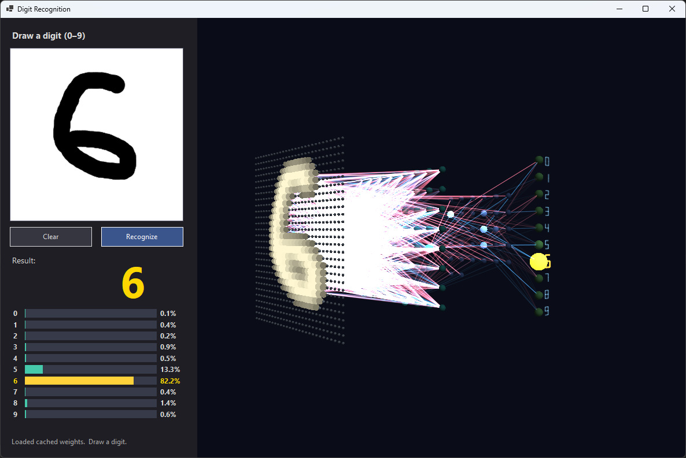

# NeuralNet3D

A WinForms app: draw a digit with the mouse on the left, and on the right see a 3D
visualization of the neural network on "bare" OpenGL (fixed-function 1.1 via P/Invoke,
no OpenTK/SharpGL/GLU).

## Requirements

- Windows (x64)
- .NET SDK
- A GPU driver with OpenGL (only 1.1 is used)
- Internet on the **first** run — to download MNIST (~11 MB)

No NuGet dependencies: only `opengl32.dll` / `gdi32.dll` / `user32.dll`, plus .NET's
`HttpClient` to fetch the dataset.

## Screenshot


## Running

```
cd NeuralNet3D
dotnet run -c Release
```

On the **first** run the app downloads MNIST into an `mnist/` folder next to the exe,
trains on it (≈1–3 minutes; progress and test accuracy are shown at the bottom left),
and saves the weights to `weights.bin`. After that the weights are simply
loaded from cache.

> If there is no internet or MNIST fails to download, the app falls back to a synthetic
> dataset (digits rendered with system fonts).
